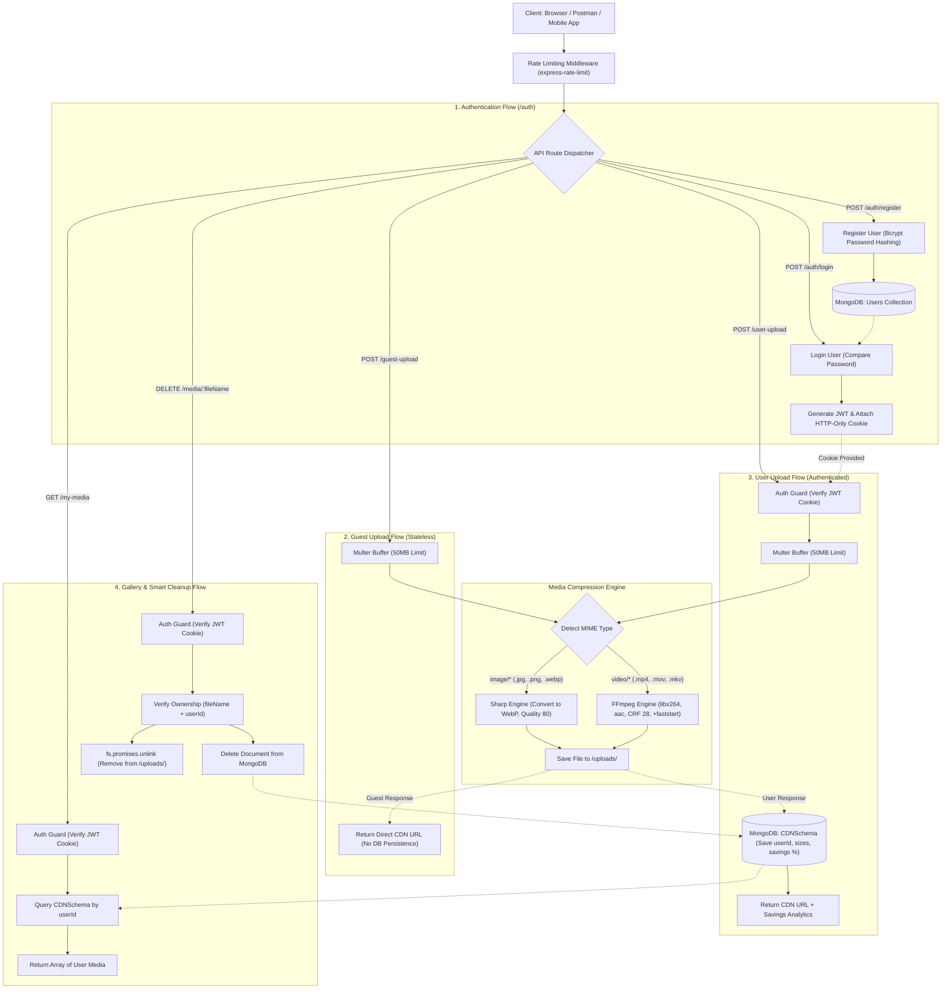

# MiniCDN - High-Performance Image and Video Compression Microservice

[](https://github.com/Faizan-Khanx/MiniCDN-Backend)
[](https://nodejs.org/)
[](https://expressjs.com/)
[](https://www.mongodb.com/)
[](LICENSE)
[](https://github.com/Faizan-Khanx/MiniCDN-Backend/stargazers)
[](https://github.com/Faizan-Khanx/MiniCDN-Backend/network/members)

This is a practical project built to implement, master, and understand core backend engineering and system design concepts, including:
- API rate limiting and brute-force mitigation using `express-rate-limit`.
- Memory streaming buffers for multipart uploads using Multer (50MB cap).
- High-throughput image compression and WebP conversion using Sharp (up to 96% reduction).
- Video transcoding and compression using Fluent-FFmpeg with H.264/AAC and `+faststart` streaming optimization (up to 90% reduction).
- Stateless authentication with JSON Web Tokens (JWT) stored in HTTP-Only cookies.
- Real-time video encoding progress tracking via event emitters.
- Atomic resource cleanup: cascading deletion from MongoDB and permanent file unlinking from disk storage.

---

## 1. How It Works (System Architecture and Lifecycle)

The microservice operates on a staged processing pipeline:



### Detailed Pipeline Stages:

1. **Incoming Request & Rate Limiting:**
   Every incoming request passes through an Express rate limiter. Requests exceeding predefined thresholds are rejected with HTTP 429 Too Many Requests.

2. **Authentication Verification:**
   For protected routes, `isAuthenticatedUser` inspects incoming HTTP-Only cookies. The JWT token is verified using the application secret key. If valid, user details (`id`, `email`, `role`) are attached to `req.user`.

3. **Multipart File Ingestion:**
   Multer intercepts incoming `multipart/form-data`. The file filter validates both MIME type and file extension (allowing image formats `.jpg`, `.jpeg`, `.png`, `.webp` and video formats `.mp4`, `.mov`, `.mkv`, `.avi`, `.webm`). Files up to 50MB are read into a memory buffer.

4. **Media Processing Engine:**
   - **Images:** Processed directly from buffer through Sharp. The image is compressed into WebP format at 80% quality and saved directly to the `uploads/` folder.
   - **Videos:** The memory buffer is written to a temporary disk location. `fluent-ffmpeg` transcodes the video using `libx264` (H.264 video codec) and `aac` (audio codec) with Constant Rate Factor (CRF) set to 28 and `-movflags +faststart`. Once encoding completes, the temporary file is unlinked.

5. **Metadata Persistence:**
   For authenticated uploads, document metadata is saved in MongoDB under `CDNSchema`, recording:
   - `userId` (owner reference)
   - `fileName` (unique timestamped file identifier)
   - `originalSize` (bytes before processing)
   - `compressedSize` (bytes after processing)
   - `savingpercent` (calculated reduction ratio)
   - `url` (relative path)

6. **Static Delivery and Safe Clean-up:**
   Files are delivered statically over HTTP at `/uploads/:fileName`. When a delete request is made, `findOneAndDelete` checks both `fileName` and `userId` to ensure ownership, then permanently deletes the physical file from disk via `fs.promises.unlink`.

---

## 2. Key Capabilities

- Up to 96% image size reduction using Sharp WebP encoding.
- Up to 90% video size reduction using FFmpeg H.264 transcoding with web-streaming optimization.
- Dual execution paths: stateless guest processing vs persistent user media tracking.
- Stateless authentication using JWT delivered over secure HTTP-Only cookies.
- Smart resource cleanup: atomic removal of database documents and physical disk storage.
- Rate-limited and validated upload pipelines up to 50MB.

---

## 3. Project Directory Layout

```text
Proj17/
├── config/
│   └── db.js                   # MongoDB connection management
├── controllers/
│   ├── authController.js       # User registration and authentication
│   └── cdnController.js        # Media ingestion, user gallery, and deletion
├── middleware/
│   ├── authMiddleware.js       # Cookie-based JWT authentication guard
│   ├── cdnMiddleware.js        # Multer memory configuration and file filters
│   ├── errorMiddleware.js      # Global application error handler
│   └── rateLimiter.js          # In-memory IP rate limiter
├── models/
│   ├── userModels.js           # User schema definition
│   └── mediaModels.js          # CDN media metadata schema definition
├── routes/
│   ├── index.js                # Primary route aggregator
│   ├── authRoutes.js           # Authentication route definitions
│   └── cdnRoutes.js            # Media processing route definitions
├── services/
│   ├── authService.js          # Password hashing and token generation
│   └── cdnService.js           # Sharp and FFmpeg transformation pipelines
├── utils/
│   ├── authHelper.js           # Validation and cryptography helpers
│   └── errorHandler.js         # AppError custom error structure
├── uploads/                    # Target directory for optimized media assets
├── .env                        # Environment configurations
├── app.js                      # Application entry point and static host
└── package.json
```

---

## 4. Technical Stack

- **Runtime:** Node.js (ES Modules)
- **Web Framework:** Express 5
- **Image Processing:** Sharp (libvips)
- **Video Processing:** Fluent-FFmpeg with @ffmpeg-installer/ffmpeg
- **File Parsing:** Multer
- **Database:** MongoDB with Mongoose ODM
- **Authentication:** JSON Web Tokens (jsonwebtoken) and cookie-parser
- **Security:** Bcrypt and express-rate-limit

---

## 5. API Reference

### Authentication

#### Register
- **Endpoint:** `POST /auth/register`
- **Payload:**
  ```json
  {
    "email": "user@example.com",
    "password": "SecurePassword123"
  }
  ```

#### Login
- **Endpoint:** `POST /auth/login`
- **Payload:**
  ```json
  {
    "email": "user@example.com",
    "password": "SecurePassword123"
  }
  ```
- **Result:** Attaches an HTTP-Only cookie named `token` valid for 15 minutes.

---

### Media Operations

#### Guest Media Upload
- **Endpoint:** `POST /guest-upload`
- **Authentication:** None
- **Payload:** `multipart/form-data` with field `file`
- **Response Format:**
  ```json
  {
    "message": "File Upload Sucessfull",
    "filetype": "image/jpeg",
    "originalSize": "5.17 MB",
    "compressedSize": "0.21 MB",
    "savingPercentage": "95.93 %",
    "url": "http://localhost:3000/uploads/media-1793115209578.webp"
  }
  ```

#### Authenticated Media Upload
- **Endpoint:** `POST /user-upload`
- **Authentication:** Required (HTTP-Only cookie)
- **Payload:** `multipart/form-data` with field `file`
- **Result:** Media is compressed, stored in `uploads/`, and logged in MongoDB under the authenticated user.

#### Retrieve User Gallery
- **Endpoint:** `GET /my-media`
- **Authentication:** Required (HTTP-Only cookie)
- **Result:** Returns an array of media objects belonging exclusively to the authenticated user.

#### Delete Media Asset
- **Endpoint:** `DELETE /media/:fileName`
- **Authentication:** Required (HTTP-Only cookie)
- **Example:** `DELETE /media/media-1794788795222.mp4`
- **Result:** Validates ownership, deletes the record from MongoDB, and unlinks the file from `uploads/`.

---

## 6. Performance Benchmarks

| Input Type | Input Format | Output Format | Input Size | Output Size | Payload Reduction |
| :--- | :--- | :--- | :--- | :--- | :--- |
| High-Resolution Image | JPEG / PNG | WebP (quality 80) | 5.29 MB | 0.21 MB | 95.9% |
| Screen Capture Video | MP4 (Raw) | MP4 (libx264 / CRF 28) | 13.35 MB | 1.38 MB | 89.6% |

---

## 7. Setup and Execution

1. Clone repository and install dependencies:
   ```bash
   git clone https://github.com/Faizan-Khanx/MiniCDN-Backend.git
   cd MiniCDN-Backend
   npm install
   ```

2. Configure environment variables in `.env`:
   ```env
   PORT=3000
   MONGO_URL=mongodb://127.0.0.1:27017/MiniCDN
   JWT_SECRET=your_jwt_secret_key
   ```

3. Launch application:
   ```bash
   npm run dev
   ```

---

## 8. License
ISC License.
